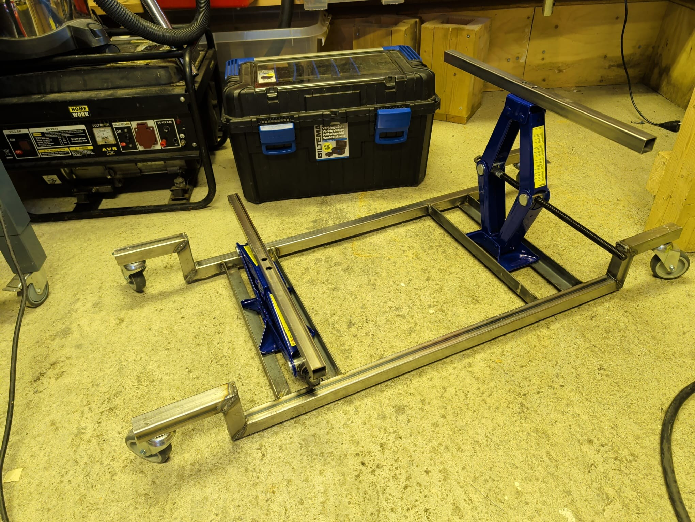
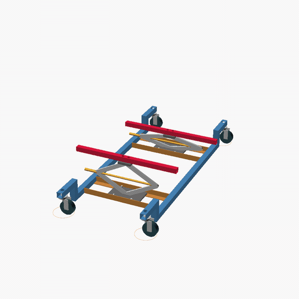

## The jack worked

[Last week's plan](/blog/week-39-the-plan/) had one goal: get the traction battery out of the i-MiEV without a lift. It came out. The cradle, two Biltema scissor jacks in a welded ladder of 30 mm box section on four castors, took the weight on two bars under the pack's belly spars, wound it down, and rolled it out. The whole thing is on video:

<iframe src="https://www.tiktok.com/player/v1/7689770496165973270?description=0&music_info=0&controls=1&rel=0" title="TikTok: dropping the i-MiEV battery on the drop dolly" style="width: 100%; max-width: 360px; aspect-ratio: 9 / 16; border: 0; display: block; margin: 1rem auto;" allow="fullscreen" loading="lazy"></iframe>

A longer cut is [on YouTube](https://www.youtube.com/watch?v=Ndd7FNhnkWo).

A few things went differently from the plan. The jacks never got bolted to the frame: there was no room for the bolt heads under the angle flanges, so they sat in their wells fenced by the angles. That was enough, and welding them in would have worked too. The car needed jacking a little higher than the 470 mm I had planned for, to get the tall middle of the pack out under the sill. And 15 mm of ground clearance is not much: with 230 kg aboard, the frame bottomed out on the bumps in the floor.

## This week

Three jobs:

1. Open the pack and take one eight-cell module out.
2. Put that module behind a pair of hoverboard wheels and make them spin on the bench.
3. Write up the cradle as its own OpenSCAD project.

## Open the pack

The pack is 88 GS Yuasa LEV50 cells in ten modules of eight and two of four. An eight-cell module is 30 V nominal, which is what the hoverboard motors want, and getting one out is why the pack came out of the car.

With the service plug out the pack is split in two halves, but each half is still over 160 V across its terminals and every module is live at its own 30 V. The modules are bolted in with bus bars between them and a cell-monitoring board on each. Bus bars off first, then one module out. It is about the size of a shoebox and, at 1.7 kg a cell, weighs about 14 kg.

## Make the wheels spin

The module then goes on the bench next to a pair of hoverboard wheels and one of the controllers from the summer. The [firmware](/blog/week-26-the-plan/) already spins a motor under six-step commutation on both board families from one image. What it has not had yet is a real battery behind it.

## Write up the cradle

The third job is to write up the cradle as its own OpenSCAD project and publish it on GitHub.

