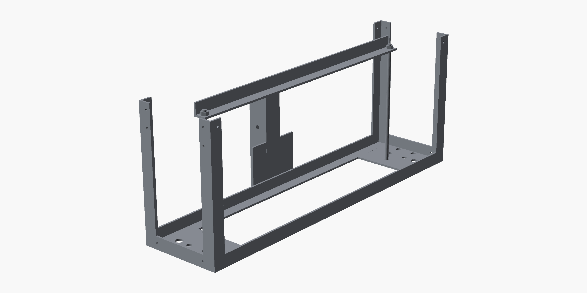
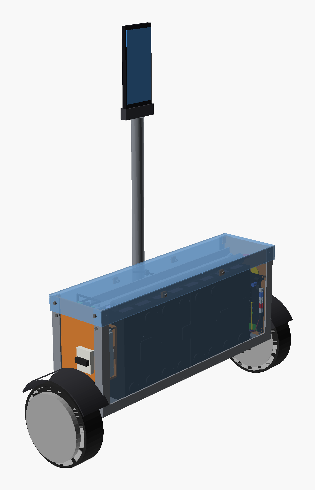
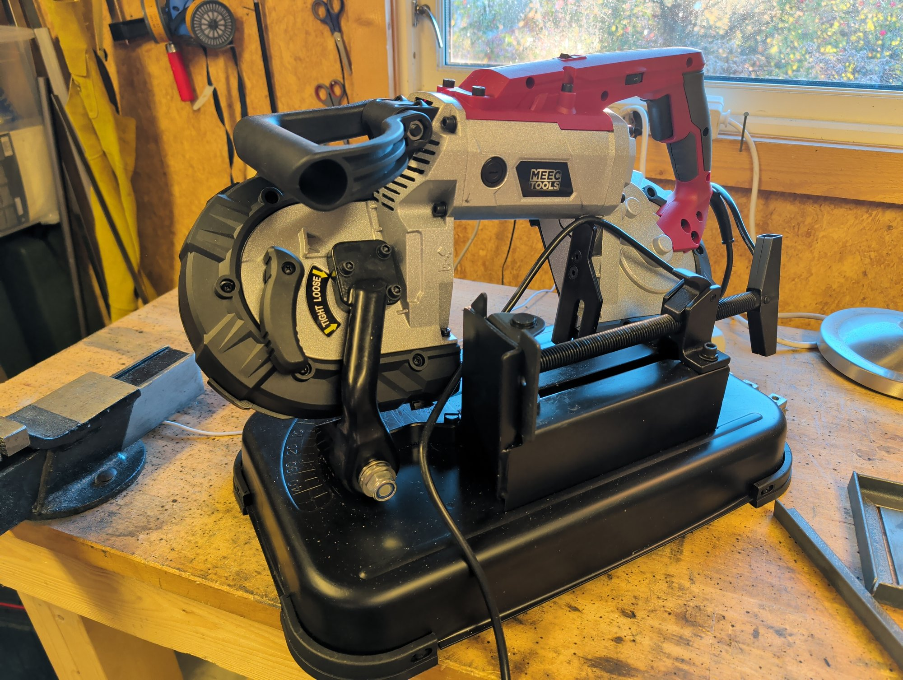
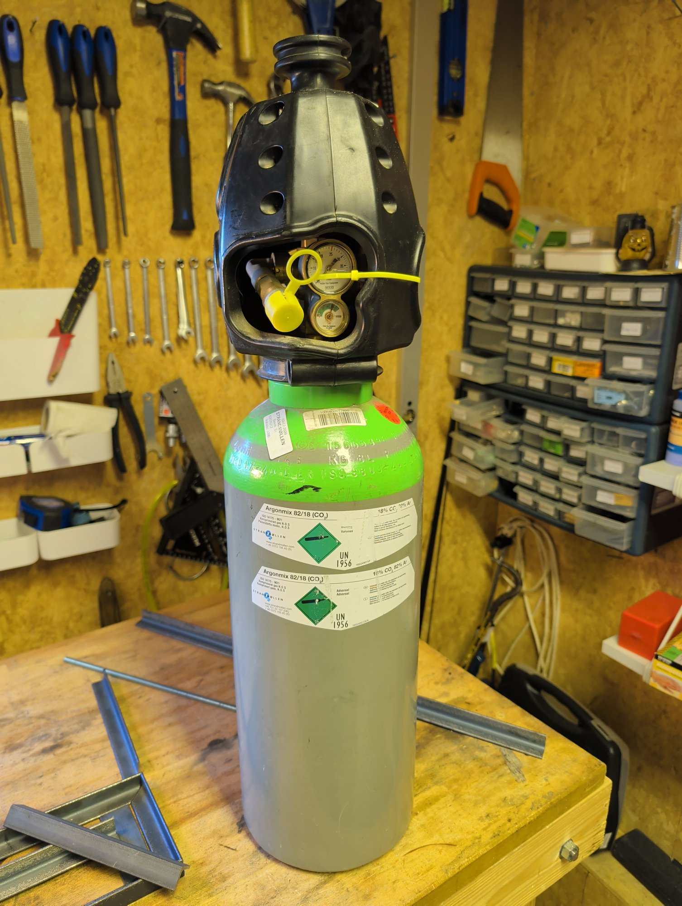

## This week

One job, in a shorter week than usual: weld the rover frame.

## The frame

The rover is designed and the steel for the frame is cut.

The whole rover in the model, with the pole drawn short to fit the picture:

## The saw

The steel was cut on a [Meec Tools ME-W HOME 300 metal band saw](https://www.jula.no/catalog/verktoy-og-maskiner/el-verktoy-og-maskiner/stasjonare-sager/metallsager/metallbandsag-020735/) from Jula. It works better than the angle grinder: the cuts are cleaner and it makes far less mess. It is a hobby-grade saw and costs 2,399 NOK.

## The gas

The welder is an ESAB HandyArc MIG 160i, which has so far run gasless flux-core wire. For less spatter it is moving to solid wire under shielding gas: an 8 l [MiniBertha bottle of Argonblanding](https://www.jula.no/catalog/verktoy-og-maskiner/sveising-og-lodding/sveising/sveisegass/argonblanding-008542/) (82 % argon, 18 % CO2) from Jula, which has the regulator built into the cap. I have not welded with it yet; the rover frame will be the first job for it this week.

## Last week

[Last week's plan](/blog/week-41-the-plan/) had two jobs:

1. Design the rover frame. ✅
2. Upgrade the workshop tools: get shielding gas for the welder, and find a better way to cut steel tube than the angle grinder. ✅
