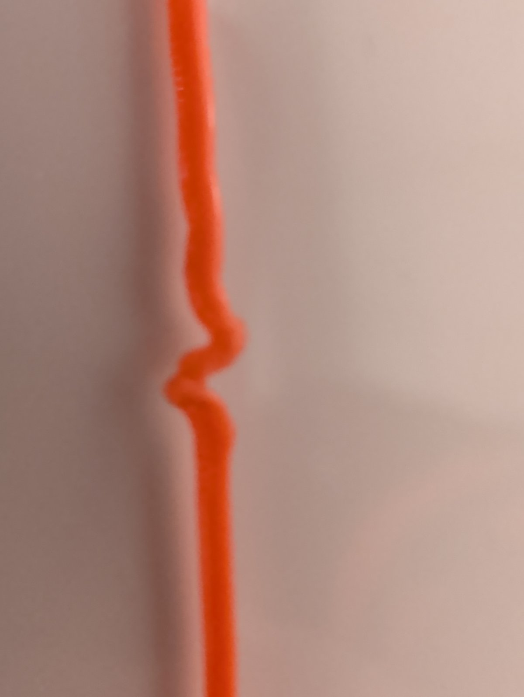
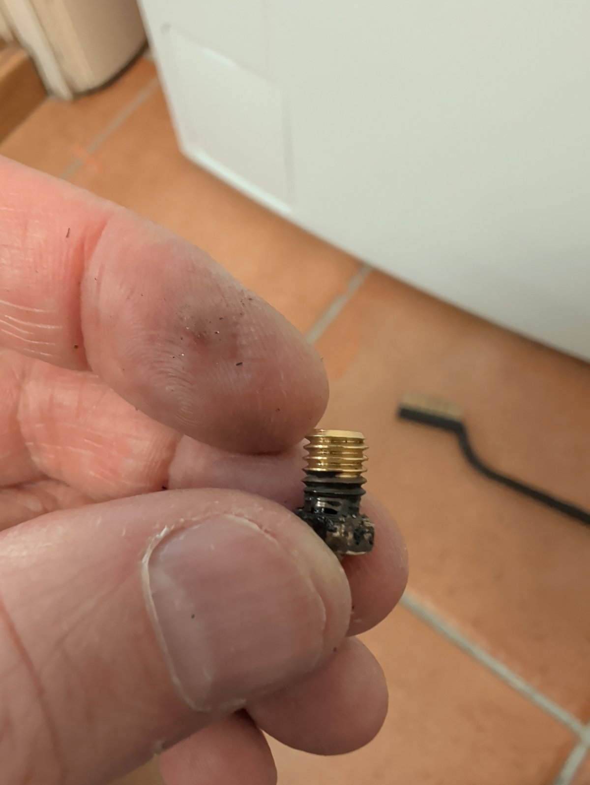

[The plan for this week](/blog/week-44-the-plan/) had four jobs:

1. Pole bush. ✅
2. Phone mount. ❌
3. Tuning. 🟡
4. Rider app telemetry. ❌

## Pole bush

The bush is a full-length TPU sleeve between the pole and its socket. The first one was printed with supports that could not be removed from TPU and would not go onto the pole. It was redrawn with a 25.3 mm bore and a thinner wall to fit the socket.

## Phone mount

The phone is now drawn in the model as its own part, with its cameras, buttons and port, and the mount and a thin TPU fit case are designed around it.

Printing the fit case was a massive headache. It stalled part way through four times on the Prusa MK3S, at different places in a 14 m print, with the extruder clicking. Each time the TPU strand had folded into an S-kink at the drive gears.

Between attempts the idler screw was backed off, PETG was purged through, and the spool was partly unwound, where the filament had caught on the side of the spool. The old nozzle came out with charred plastic on its lower threads and a loose heater block, so a new nozzle was fitted; the next print stalled the same way. A flow test in air, ramping up to 6 mm³/s, ran without a click. The cause was never diagnosed. It might have been the idler screw set too tight, or imperfections in the filament.

One fit case finally printed. On the phone it did not follow the phone's contours closely enough, the open bottom splayed outwards, and it did not look like it would hold the phone in a fall. The second version copies its edge profile from a published case on Printables that fits the phone, grips by stretching over the phone, has a closed bottom ring with a slot for the USB-C port, and has thinner walls: 28 g against 42. It is printing now.

## Tuning

The balance law was replaced: a four-term state feedback took over from the PID cascade, and the app's Tune screen tunes it live.

The firmware's FOC mode, recovered from the stock firmware, was replaced with a rewrite: the motor controller closes two current loops, and the balance demand is a torque (q-axis current) reference. It went in as a series of slices, tested on the bench pair and then on the rover.

On FOC the rover's slave board whined at rest and ran rough. Its current-sense zero wanders by about 5 ADC counts within seconds, and the current loop drives that error into the motor. The board was replaced with a spare, which first had to be recovered: its old firmware had locked out SWD, and it was mass-erased through the wireless bridge with its reset pin clipped on. On the new slave FOC is almost silent at rest.

The rover balanced on FOC. It does not yet drive easily from the app's joystick.

## Rider app

The telemetry tidy-up did not happen. The app did gain a battery chemistry setting, with a resting-voltage table per chemistry and a warning near the pack's floor voltage.

The app's job also changed. Setting up a board is now done from the command line, with `hoverboard-cli`, and the app is for tuning and driving. It keeps its pin editor; the board-layout presets go, since their current-sense pins were wrong or never measured on a bench. The CLI is easier to test than the app.

## Configuration from the CLI

`hoverboard-cli` now holds a board's settings as a JSON file, one file per board, with every setting under a readable name such as `motors[0].hall.a`:

- `dump` saves a board's settings to a file;
- `diff` shows what a file would change, and writes nothing;
- `apply` merges a file in, never deletes a setting, and prints what changed;
- `replace` makes the board match the file exactly, after asking.

`dump` and then `replace` gives a backup and restore.

## BLE through the bridge

The boards' onboard CC2541 BLE module is no longer supported, because there is not enough flash for it: removing its support frees about 5.4 KB, and the image was close to its ceiling with the FOC work. It was handy because it comes built into the hoverboards I own. The phone now connects over BLE to the ESP32 bridge, which talks to the board over SWD. If driving over SWD is stable, and early indications are that it is, nothing has been lost. A UART link between the bridge and a board would also be possible, but it is untested, and I have little reason to build it while SWD works.

## Other firmware work

- A bridge keeps its Wi-Fi credentials in its settings, with a password that can be written but not read back, and `hoverboard-cli install-esp` makes a bridge from a blank ESP32-C3 SuperMini over USB in one command.
- `hoverboard-cli` is built for macOS, Linux and Windows on GitHub.

## Where it stands

The bush is done. The first phone fit case printed after many failed attempts, and the second version is on the printer. The rover balances on FOC with a new slave board, and the tune does not yet make it easy to drive. The app's telemetry looks as it did.
