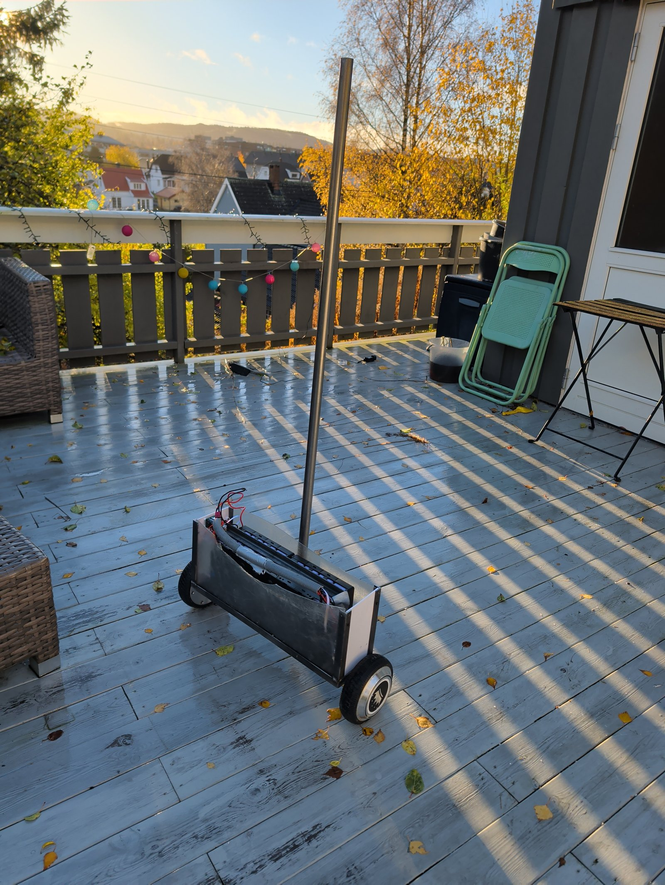

## This week

Four jobs:

1. **Pole bush.** A printed TPU sleeve between the pole and its socket, to damp the pole.
2. **Phone mount.** Design and print a TPU cage for the phone at the top of the pole, so that a fall lands on TPU and not on the phone.
3. **Tuning.** Tune the balance until the rover drives easily from the rider app's joystick, standing beside it.
4. **Rider app.** Tidy up the app, starting with how the telemetry is shown.

## Built and balancing

The rover was built in week 43 and balanced for the first time on 23 October.

The welded frame came out a little off the model: the uprights lean by up to 4 mm. The frame was measured as built and the PET side walls were drawn and cut to those measurements, not to the model.

The [firmware](https://github.com/hoverboardhavoc/hoverboard-firmware) got a rigid-frame mode for the rover: one IMU drives both wheels as one machine, so a turn cannot become a fall. Past 45 degrees of tilt it disengages and stops both wheels. The rider app sets the rover up from the phone and arms it.

It balances. The tune can be improved, and the first run turned up a list of fixes:

- A mudguard snapped off in a fall. The mudguards were premature: I spent time designing and printing them before the machine balanced, which was a mistake.
- The PET end walls, held only at their ends by the side walls' edges, pop out.
- The lower side-wall bolts cannot be screwed in with the wheels on: the hub motors are in the way.
- The 5 V wiring between the two boards is untidy, and its runs down the side walls pass close to the threaded rods.

## Welding the frame

The frame was welded in week 42. The band saw cut the steel much better than the angle grinder did, and welding with gas was much better than with the flux-core wire.

## Last week

[The week 42 plan](/blog/week-42-the-plan/) had one job:

1. Weld the rover frame. ✅

Week 43 had no plan post. What got done:

1. Side walls cut to the frame as built. ✅
2. The rover wired and assembled. ✅
3. A rigid-frame mode and a tilt cutout in the firmware. ✅
4. First balance, on 23 October. ✅
5. A wireless bridge (an ESP32-C3 board) and a terminal tool, to flash, debug and drive the boards without the phone. ✅
6. The pole bush designed. ✅
